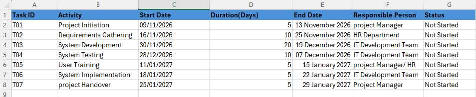
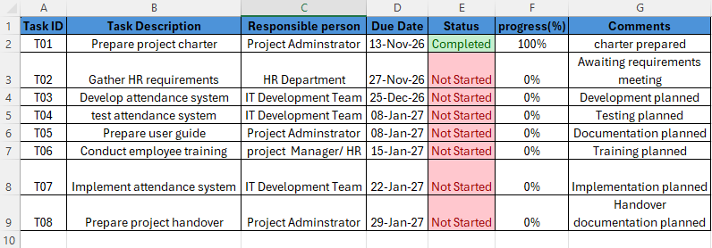
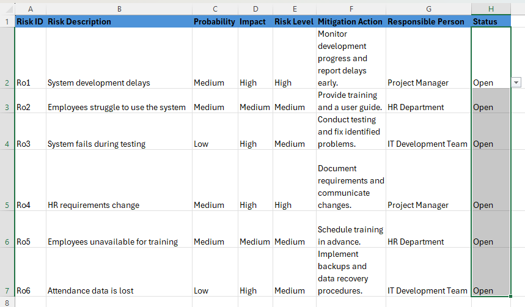
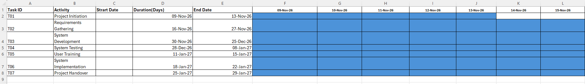
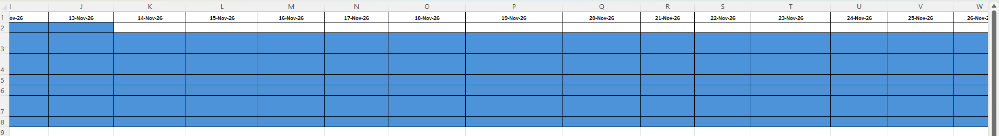

# Lesedi Moraba | Project Administration Portfolio

A personal portfolio website for **Lesedi Moraba**, a final-year BSc Information Technology student at North-West University (NWU) building a career in **project administration, project coordination and IT project support**.

**Live site:** https://morabalesediportfolio.netlify.app/

---

## About this project

The site presents my project administration skills through a simulated portfolio project and the documents that came out of it. It is designed to be recruiter-friendly: clear structure, quick to scan, and easy to view on a phone or a computer.

> **Important:** the featured project, *Employee Attendance Management System Implementation* for *BrightPath Solutions*, is a **simulated portfolio project**. BrightPath Solutions is a fictional company. It is **not real employment experience**, and the attendance system was **not built or implemented**. Everything on the site is labelled accordingly.

## What's on the site

| Section | What it shows |
|---|---|
| **Home** | Introduction, headline and links to projects, CV and contact |
| **About** | My IT background and my interest in project administration |
| **Skills** | The areas I'm developing: documentation, scheduling, task tracking, risk management, progress reporting, coordination |
| **Projects** | The simulated BrightPath project: background, role, deliverables, risk overview and a proposed 12-week timeline |
| **Documents** | A gallery of the project documents, each viewable page by page |
| **CV** | A preview of my CV, with View and Download buttons |
| **Contact** | LinkedIn, GitHub and email |

### The simulated project documents

1. Project Charter
2. Project Schedule
3. Task Tracker
4. Risk Register
5. Gantt Chart
6. Meeting Minutes
7. Project Progress Report
8. Project Closure Report
9. Project Presentation

Documents open as page-by-page screenshots in a viewer (previous/next arrows, page counter, keyboard support). Only the CV can be downloaded.

## Document previews

A few of the simulated project documents. The full set can be viewed page by page on the [live site](https://morabalesediportfolio.netlify.app/).

### Project Schedule


### Task Tracker


### Risk Register


### Gantt Chart




*These documents belong to a simulated portfolio project. The project is proposed only, and nothing in it was implemented.*

## Features

- Sticky navigation with active-section highlighting and a mobile menu
- Scroll-triggered reveal animations, animated counters and an animated timeline
- Interactive skill cards, expandable project details and a risk overview
- Document viewer with multi-page navigation
- Working CV download and a copy-to-clipboard email button
- Responsive layout for desktop, tablet and mobile
- Respects the `prefers-reduced-motion` setting

## Built with

- HTML, CSS and vanilla JavaScript (no framework and no build step)
- [Lucide](https://lucide.dev/) icons, loaded from a CDN
- Google Fonts (Sora and Inter)

## Project structure

```
.
├── index.html                  # The whole website (HTML, CSS and JavaScript)
├── README.md
├── .nojekyll
├── project_schedule.png        # Images displayed in this README
├── Track_tracker.png
├── Risk_Register.png
├── gantChart1.png
├── gant2.png
└── assets/
    ├── Lesedi_Moraba_CV.pdf    # CV (copy of the downloadable file)
    ├── cv/                     # CV page images shown by "View CV"
    └── docs/                   # Document screenshots (charter, gantt, minutes, etc.)
```

## Run it locally

No installation is needed.

1. Download or clone this repository.
2. Open `index.html` in a browser.

Or serve it locally:

```bash
python -m http.server 8000
# then open http://localhost:8000
```

## Deploy

The site is static, so it works on any free static host.

**GitHub Pages:** go to **Settings > Pages**, choose **Deploy from a branch**, select **main** and **/ (root)**, then save.

**Netlify:** drag the project folder into the Deploys page of your site.

## Updating the content

- **Document images:** replace the files in `assets/docs/` using the same file names.
- **CV:** replace `assets/Lesedi_Moraba_CV.pdf` and the images in `assets/cv/`. The Download CV button uses a copy of the PDF stored inside `index.html`, so that copy needs updating too.
- **Text, links and email:** edit `index.html`. The `EMAIL` and `CV_FILE` values are near the top of the script.

## Contact

- LinkedIn: https://www.linkedin.com/in/lesedi-moraba-084a6b31a
- GitHub: https://github.com/lesedi-61
- Email: morabalesedi61@gmail.com

---

© 2026 Lesedi Moraba. All rights reserved. The simulated project content is for portfolio demonstration only.
